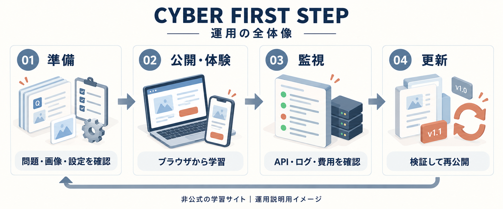
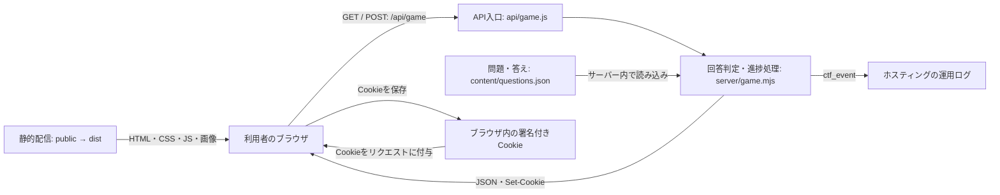
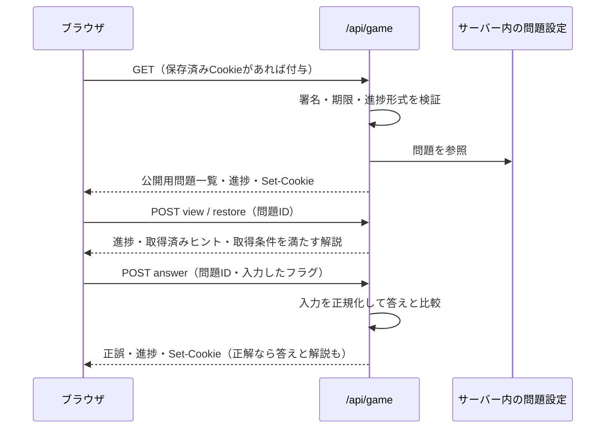

# CYBER FIRST STEP

防衛省職員向けの運用・引継ぎガイド。初心者向けCTF体験サイトを、広報・学習イベントで運用するための手順、APIの動作、更新するファイルをまとめています。

**現行サイトは学生企画・非公式のプロトタイプです。** このREADMEは運用を検討する担当者向けの資料で、防衛省による採用・公認・庁内システムへの接続を示すものではありません。組織で利用する場合は、利用目的、公開範囲、使用端末・ネットワーク、素材の利用条件を運用主体で確認してください。



図はAI生成の運用説明用イラストです。実装の構成は後述の図とAPI仕様を参照してください。[生成方法・プロンプト](docs/image-prompts/operations-overview.txt)も保存しています。

## 目次

- [このサイトでできること](#このサイトでできること)
- [担当者と引継ぎ](#担当者と引継ぎ)
- [運用の流れ](#運用の流れ)
- [起動と公開設定](#起動と公開設定)
- [システム構成とAPI](#システム構成とapi)
- [APIとデータの注意点](#apiとデータの注意点)
- [ディレクトリ構成](#ディレクトリ構成)
- [問題と画面の更新](#問題と画面の更新)
- [確認コマンドと障害対応](#確認コマンドと障害対応)
- [関連資料](#関連資料)

## このサイトでできること

スマートフォン・タブレット・PCのブラウザで、画像や架空の記録から合言葉（フラグ）を探します。現在の問題設定は８問で、登録やアプリの導入は不要です。

| 機能             | 動作・運用上の意味                                                                                       |
| ---------------- | -------------------------------------------------------------------------------------------------------- |
| 問題への挑戦     | 暗号、文字コード、画像の観察、ログ・記録の照合、時系列の整理などを体験                                   |
| ヒント・解説     | 各問に２段階のヒント。ヒントの使用による減点なし。解説では答えも表示                                     |
| 進捗の表示       | 自力の「正解」と「解説で学習」を分けて表示。先に解説を見た問題は、その後正解しても自力の正解数に加えない |
| 再開             | 同じブラウザの署名付きCookieで進捗を保存。別端末への同期は未実装                                         |
| 公式案内への誘導 | 問題を解かずに大会案内へ進むことも可能。応募はリンク先で行う                                             |
| 運用計測         | 開始・問題表示・正解・ヒントなどのイベントをサーバーログに記録                                           |

アカウント、職員認証、管理画面、ランキング、個人別成績台帳、集計ダッシュボード、データベースは未実装です。自由に解説を開けるため、用途は体験・学習を想定しています。本人確認や厳密な採点が必要な試験に使う場合は、別途設計が必要です。

## 担当者と引継ぎ

以下は担当を決める際の例です。実際の所属名、担当者、代替担当者、連絡先は組織内の引継ぎ先で管理します。

| 役割           | 主な作業                                       | 引き継ぐ内容                                         |
| -------------- | ---------------------------------------------- | ---------------------------------------------------- |
| 運用責任者     | 利用目的・公開範囲・実施日程・停止判断を決める | 承認済みの運用範囲、緊急連絡経路、公開・停止の判断者 |
| 教材・広報担当 | 問題・解説・画像・公式案内への導線を確認する   | 編集対象、素材の出典・利用条件、掲載内容の確認記録   |
| 技術担当       | 起動・テスト・公開・監視・復旧を行う           | リポジトリ、公開先、環境設定、直前の正常版、復旧手順 |
| 当日の案内担当 | 遊び方、ヒント、進捗の扱いを説明する           | 利用者向け説明、動作確認済みの端末、問い合わせ先     |

秘密鍵そのものをREADMEや引継ぎメールに書かず、権限管理された保管先と参照権限を引き継ぎます。公開リポジトリに実際の内部連絡先を記載しないでください。

## 運用の流れ

### 1. 導入・イベント前に準備する

1. 体験の目的、対象者、公開期間、問い合わせ・停止の担当を決めます。庁内端末やネットワークを使う場合は、外部サイト・ホスティングサービスの利用可否を確認します。
2. 架空の教材を使用し、実業務の文書、実在するシステムのログ、個人情報、認証情報を問題や画像へ入れないことを確認します。
3. 問題・画像・解説の整合性、非公式の表示、マスコット等の素材の利用条件、公式案内リンクを確認します。募集状況や日程は、実施時点の公式案内を担当者が確認します。
4. 技術担当がローカル確認と自動テストを行い、公開前の検証環境で実際の操作を確認します。
5. 想定同時利用数に合わせて負荷・費用・ログの扱いを確認し、公開先と正常版の復元先を記録します。負荷試験と初心者による所要時間の実測は、実施計画に含めてください。

### 2. 公開直後・当日の開始前に確認する

1. 利用者と同じ端末・ネットワークからトップページを開き、問題と画像を表示します。
2. 検証用のブラウザで、不正解・正解・ヒント２段階・解説・再読み込み後の進捗復元を確認します。
3. APIの応答、HTTPS時のCookie、公式案内への遷移を確認します。`/content/questions.json` と `/server/game.mjs` がWebから取得できないことも確認します。
4. 技術担当がエラーログと費用を確認できる状態にし、当日の担当者へ連絡経路を共有します。

本番での動作確認もイベントログに計上されます。確認した時刻と操作を記録し、後の集計で考慮してください。

### 3. 利用者を案内する

「登録不要」「１問だけでも参加可能」「ヒントは無料」「解説を読むだけでも学べる」「進捗はこのブラウザに保存される」を最初に説明します。調査は教材内で完結します。

共用端末では、利用者の交代時に結果画面から進捗をリセットします。Cookieを消す、プライベートブラウズを終了する、別端末へ移ると以前の進捗を利用できなくなることも伝えてください。

### 4. 監視・終了後の振り返りを行う

以下は頻度の目安です。自動監視や通知は、このリポジトリには組み込まれていません。

| タイミング             | 確認するもの                                      | 対応・記録                                   |
| ---------------------- | ------------------------------------------------- | -------------------------------------------- |
| 公開日・開催日の開始前 | トップ、API、画像、回答、進捗復元、公式リンク     | 操作結果と確認日時を記録                     |
| 開催中・アクセス増加時 | APIの失敗・遅延、ホスティングの障害、利用量・費用 | 異常が続けば広報を一時停止し、技術担当へ連絡 |
| 教材・設定の更新時     | テスト結果、差し替え内容、進捗リセットの有無      | 確認者、変更内容、公開した版を記録           |
| 開催後・定期見直し時   | イベント集計、問い合わせ、利用権限、ログ保持      | 改善点と次回の対応を整理                     |

イベント数は延べ操作数を含みます。`official_click` は大会案内のクリックで、応募完了や実人数を表しません。個人別の受講証明にも使用できません。

## 起動と公開設定

### ローカルで起動する

このリポジトリは **Node.js 24.x** を指定しています。PowerShellなどのターミナルで、リポジトリのルートに移動して実行します。

```sh
npm ci
npm run dev
```

ブラウザで http://127.0.0.1:3000 を開きます。`npm ci` は初回と依存関係の更新時に実行します。`npm run dev` は問題設定・サーバー等の変更を監視するので、保存後に画面を再読み込みしてください。CSSは再読み込みで反映されます。

初回起動時、環境変数に署名鍵がなければランダムな `CTF_SESSION_SECRET` を生成し、`.env.local` に保存します。以後の起動ではこの鍵を読み込みます。`.env.local` はGit・公開対象から除外されています。

ローカルサーバーは `127.0.0.1` にだけ接続を受け付けます。別のスマートフォンから直接接続するための配信サーバーとしては使わず、実機確認には検証用の公開環境などを用意してください。

### Vercelへ公開するための設定

このリポジトリの [vercel.json](vercel.json) と運用資料に基づく設定です。

| 設定             | 内容                                                   |
| ---------------- | ------------------------------------------------------ |
| Framework        | Other / `null`                                         |
| Node.js          | `package.json` の指定に合わせた24.x                    |
| Build Command    | `npm run build`                                        |
| Output Directory | `dist`                                                 |
| APIの入口        | `api/game.js` → `server/game.mjs`                      |
| 必須環境変数     | `CTF_SESSION_SECRET`：32文字以上の十分ランダムな秘密値 |

1. 運用用のホスティングプロジェクトとアクセス権を準備します。
2. 公開・検証する各環境に署名鍵を設定します。検証環境と本番環境では別の鍵を使います。
3. `npm run check`、`npm test`、`npm run build` を成功させ、検証環境で確認した版を公開します。
4. 公開後、前述の開始前確認を実施し、公開日時・版・担当者・復元先を記録します。

`dist/` は `public/` の静的ファイルだけです。**静的ファイルだけをホスティングしても回答判定は動きません。** APIと、その実行に必要な `server/`・`content/` もサーバー側へ配置する構成が必要です。

現在の設定ファイルには、独自の全体レート制限や予算通知の設定は含まれていません。一般公開の規模に合わせ、ホスティング側のアクセス制御・利用量の通知などを運用主体で整えてください。

## システム構成とAPI

### 画面・サーバー・保存先の関係



ブラウザの [public/app.js](public/app.js) が同じサイトの `/api/game` と通信します。[api/game.js](api/game.js) はサーバーの処理を呼び出す入口です。ローカルでは [scripts/dev.mjs](scripts/dev.mjs) が同じ判定処理を呼び出します。

問題は [server/challenges.mjs](server/challenges.mjs) を通して設定ファイルから読み込みます。**現行の実行処理に生成AI APIの呼び出しはありません。** このREADMEのイラストは制作時に生成した画像ファイルです。公式サイトへの遷移も通常のリンクで、応募受付APIとの連携はありません。

### 問題を開いて回答するまで



### エンドポイントと送信形式

| 項目               | 仕様                                                                      |
| ------------------ | ------------------------------------------------------------------------- |
| パス               | `/api/game`                                                               |
| メソッド           | `GET`、`POST`                                                             |
| POSTのContent-Type | `application/json`                                                        |
| POST本文           | JSONオブジェクト。アプリ側の読み取り上限は4,096バイト                     |
| 進捗の引継ぎ       | `ctf_progress` Cookie。クライアントは受け取った最新Cookieを次の通信に使う |
| 正常応答           | JSON。各操作に共通して `progress` を返す                                  |
| エラー応答         | ハンドラーが扱うエラーは `{"error":"説明文"}`                             |
| キャッシュ         | `Cache-Control: private, no-store`                                        |

`GET /api/game` は `challenges` と `progress` を返します。問題一覧から `answer`・`hints`・`explanation`・`learning` を除き、ヒント数の `hintCount` を付けます。問題文・画像パス・調査用の `material` は公開情報です。

`GET /api/game?source=event` のように指定すると媒体を記録します。有効値は `school`・`x`・`event`、新規進捗で未指定なら `direct` です。画面のURLに同じパラメーターを付けると、画面側が最初のGETへ引き継ぎます。職員番号などの識別子を追加しないでください。

### POSTの操作一覧

`action` は文字列です。`id` が必要な操作では、設定に存在する整数の問題番号を指定します（現行は１〜８）。文字列の `"1"` とは区別されます。

| `action`      | 追加するフィールド | 主な応答と進捗への影響                                                                                          |
| ------------- | ------------------ | --------------------------------------------------------------------------------------------------------------- |
| `view`        | `id`               | 問題を閲覧済みにする。最初の閲覧で `start`、問題の初回閲覧で `view` をログ出力                                  |
| `answer`      | `id`, `answer`     | `correct` を返す。正解時は答え・解説・学習内容・`assisted` も返す。先に解説を見ていなければ自力の正解として記録 |
| `hint`        | `id`               | 表示済みの `hints` を配列で返す。呼び出すたびに１段階進み、最大２段階                                           |
| `explanation` | `id`               | `answer`・`explanation`・`learning`・`assisted` を返す。未正解なら「解説で学習」として記録                      |
| `restore`     | `id`               | 表示済みヒントを返す。正解済み・学習済みなら答えと解説も返す                                                    |
| `reset`       | なし               | 現在のブラウザの進捗を新規状態に置き換える                                                                      |
| `official`    | なし               | 公式案内のクリックを、同じ進捗内で初回だけ記録。遷移自体は画面のリンクが行う                                    |

`progress` は `solved`（自力の正解ID）、`learned`（解説で学習したID）、`viewed`（閲覧したID）、`hints`（問題順の表示段階０〜２）の各配列です。不正解も通信が正常ならHTTP 200と `correct: false` になります。

### PowerShellでのローカル確認例

`npm run dev` を起動したまま、別のPowerShellで実行します。`YOUR_FLAG` は入力例なので、正解させる場合は教材のフラグに置き換えます。

```powershell
$baseUrl = 'http://127.0.0.1:3000'
$initial = Invoke-RestMethod -Uri "$baseUrl/api/game" -SessionVariable ctfSession
$initial.challenges | Select-Object id, title, hintCount

$payload = @{ action = 'answer'; id = 1; answer = 'YOUR_FLAG' } | ConvertTo-Json
$result = Invoke-RestMethod -Uri "$baseUrl/api/game" -Method Post `
    -ContentType 'application/json; charset=utf-8' -Body $payload -WebSession $ctfSession
$result.correct
$result.progress
```

同じ `$ctfSession` を使い続けると、APIが更新するCookieも引き継げます。Cookieや署名鍵を調査記録へ貼り付けないでください。

## APIとデータの注意点

### 進捗・署名鍵

- CookieはHMAC-SHA256による署名で改ざんを検知します。暗号化はしていません。進捗、ランダムな内部ID、期限などを持つため、認証情報や個人情報を追加しないでください。
- `HttpOnly`・`SameSite=Strict`・`Path=/`・`Max-Age=2592000` を付けます。Vercel環境、または `x-forwarded-proto: https` の場合は `Secure` も付きます。
- サーバーが検証する期限は、新規進捗を作成してから30日です。APIを使い続けても、この内部期限は延長されません。
- Cookieの削除・期限切れ・検証失敗・署名鍵の変更・`progressVersion` の変更などで、新しい進捗になります。現在はサーバー側の復元用台帳がありません。
- `CTF_SESSION_SECRET` は署名用のサーバー秘密値です。利用者が送るAPIキーではありません。短い値や未設定はAPIのエラー原因になります。
- 鍵漏えい時は運用責任者へ連絡し、影響を確認して鍵を更新・再公開します。その際、既存進捗が無効になることを案内してください。過去版へ戻しても、鍵や問題の版が合わなければ進捗は復元できません。

### 公開範囲・通信

- APIに職員認証や利用者ごとの権限管理はありません。POST時のOriginホスト比較と `Sec-Fetch-Site` の検査は、利用者の本人確認を行うものではありません。組織内限定で使う場合は、配信経路全体のアクセス制御を別途用意してください。
- 初回GETでは答えを除外しますが、`explanation` は未正解でも答えを返します。これは学習用の仕様です。問題ファイルが読めるリポジトリ利用者も答えを確認できます。
- 回答は100文字以内で、空欄は不可です。全角英数字等をNFKC正規化し、前後の空白と任意の `flag{...}` を処理して大文字で照合します。途中の空白は取り除きません。
- 回答送信の間隔が750ミリ秒未満なら429を返します。Cookieに基づく制御で、Cookieを捨てた通信も止める全体レート制限ではありません。
- 画面側は通信を順番に処理し、Web Locks対応ブラウザでは同じブラウザのタブ間でも処理を調整します。外部クライアントの並行操作まで整合性を保証する仕組みではありません。
- 画面側のタイムアウトは12秒です。タイムアウトでもサーバー処理が済んでいる場合があります。再読み込みで進捗を確認してから再操作し、ヒント等を無条件に自動再送しないでください。
- API応答をCDNやプロキシで共有キャッシュしないでください。独自プロキシを置く場合は、Cookieと送信元関連ヘッダー、HTTPSの認識を検証します。
- CSPなどの配信ヘッダーは [vercel.json](vercel.json) にあります。別の配信基盤へ移す場合も、同じ制約が適用されることを確認してください。

### ログ・集計

アプリは `type: "ctf_event"` のJSONを標準出力へ書きます。イベント名は `start`・`view`・`solve`・`learn`・`hint`・`complete`・`official_click` です。`complete` は全問が「正解」または「解説で学習」になった時点で記録されます。

```json
{ "type": "ctf_event", "event": "view", "source": "event", "challenge": 1 }
```

アプリのイベントJSONには氏名・メール・IP・回答文字列・内部IDを出力しません。一方、ホスティング基盤のアクセスログにはIP等が含まれ得ます。閲覧権限、利用目的、保存期間、必要なら外部保存先を運用主体で決めてください。

Cookieや端末の変更、並行操作により重複が発生し得るため、イベント数を一意の人数として報告しないでください。長期集計や障害通知の仕組みは別途整備が必要です。

## ディレクトリ構成

```text
.
├── README.md                     本資料：運用・API・構成の入口
├── content/
│   └── questions.json            問題・答え・ヒント・解説・進捗バージョン
├── public/                       ブラウザに配信するファイル
│   ├── index.html                ヘッダー・フッター・共通ダイアログ
│   ├── app.js                    API通信・画面遷移・回答提出・進捗反映
│   ├── header.js                 ヘッダー高さの調整
│   ├── theme.css                 配色・共通フォント等
│   ├── styles.css                配置・余白・スマホ対応・演出
│   ├── assets/                   問題画像・アイコン・マスコット
│   └── scripts/
│       ├── pages.js              トップ・問題・結果・紹介ページ
│       ├── materials.js          画像切替・選択・並べ替え操作
│       ├── dialogs.js            拡大・確認ダイアログ
│       └── ui.js                 文字のエスケープ・アイコン・結果演出
├── server/                       サーバー側の処理
│   ├── challenges.mjs            設定読込・公開用データ作成・回答正規化
│   ├── game.mjs                  回答判定・Cookie署名・進捗・イベント
│   └── validate-content.mjs      問題設定の形式・必須項目の検証
├── api/
│   └── game.js                   Vercel Functionの入口
├── scripts/
│   ├── dev.mjs                   ローカルサーバー・署名鍵の初期生成
│   ├── check.mjs                 設定と画像ファイルの存在確認
│   ├── build.mjs                 public/をdist/へコピー
│   ├── deployment-files.mjs      配置用ファイル一覧の書き出し補助
│   └── make-boards.mjs           比較用ボード画像の作成補助
├── tests/                        判定・設定・配置・ブラウザ操作の検証
├── docs/
│   ├── maintenance.md            問題設定の項目・編集方法
│   ├── operations.md             公開運用の詳細・素材の出典・制限
│   ├── images/                   README用の生成画像
│   ├── image-prompts/            画像の生成方法とプロンプト
│   └── *記録.json                過去の公開・端末検証記録
├── package.json / package-lock.json  Node.js指定・実行コマンド・依存関係
├── vercel.json                   ビルド・配信先・セキュリティヘッダー
├── .gitignore / .vercelignore    Git・配置対象からの除外
├── .env.local                    ローカルの秘密値（自動生成・Git対象外）
├── dist/                         ビルド結果（生成物・Git対象外）
├── node_modules/                 インストールした開発用依存（Git対象外）
└── test-results/                 ローカルのテスト出力（Git対象外）
```

`public/` に置いたものは、ビルド時に `dist/` へすべてコピーされます。秘密値や問題設定の原本を入れないでください。`content/`・`server/` はサーバー実行に必要ですが、静的配信先にはコピーしません。READMEの画像は `docs/images/` に置き、サイトの配信対象には加えていません。

`dist/` は毎回作り直されるため、編集は元ファイルへ行います。`deployment-files.mjs` はサーバー用の問題設定も含む配置用データを標準出力へ出す補助スクリプトで、実行だけで公開されるものではありません。出力には答えが含まれるため、公開資料や共有ログへ貼り付けないでください。

## 問題と画面の更新

| 変更したいもの                             | 編集するファイル                                   |
| ------------------------------------------ | -------------------------------------------------- |
| 問題文・答え・ヒント・解説・画像パス       | [content/questions.json](content/questions.json)   |
| 問題に使う画像                             | `public/assets/` に追加し、問題設定から参照        |
| 配色・共通フォント・トップの小見出しサイズ | [public/theme.css](public/theme.css)               |
| 余白・ボタン・スマホの配置                 | [public/styles.css](public/styles.css)             |
| トップ・紹介ページの文章、公式リンク       | [public/scripts/pages.js](public/scripts/pages.js) |
| ヘッダー・フッター・固定ダイアログの文章   | [public/index.html](public/index.html)             |

1. 変更前の版を残し、対象のファイルを編集します。画像の文字、画像説明、手がかり、答えを合わせて確認します。
2. 問題IDは配列順に１からの連番にします。現在の設定上限は、Cookie容量を考慮した32問です。
3. 同じIDを別問題にする、答えを変える、削除・並べ替えを行う場合は、`progressVersion` を１増やします。公開すると以前の進捗が無効になるため、利用者への案内を準備します。誤字・配色の修正だけなら増やしません。
4. 問題数を変えると既存Cookieの形式も合わなくなり、進捗が初期化されます。判定や進捗の問題数は設定から計算しますが、`public/index.html` の説明文などにある「８問」の固定表記は別途確認してください。
5. 設定確認・テスト・ビルドを行い、検証環境で確認してから再公開します。画像の存在チェックだけでは、画像内の文字と答えの整合性は検証できません。

問題の各項目・素材形式・画像の差し替え方法は、[運用・編集ガイド](docs/maintenance.md)を参照してください。通常の教材更新では、Cookieや回答判定のコードを触る必要はありません。

## 確認コマンドと障害対応

### 更新時の基本確認

```sh
npm run check
npm test
npm run build
npm run format:check
```

| コマンド               | 確認内容                                                   |
| ---------------------- | ---------------------------------------------------------- |
| `npm run check`        | 問題ID・必須項目・素材形式・ヒント数・画像ファイルの存在   |
| `npm test`             | 回答判定、署名・期限、進捗、設定不備、配置ファイルの出力等 |
| `npm run build`        | 設定確認後に `dist/` を再生成                              |
| `npm run format:check` | 対象ソース・設定・README等の整形状態                       |
| `npm run format`       | 同じ対象ファイルを自動整形する。更新後の差分を確認         |

画面の変更時は、ローカルサーバーを起動したまま別のターミナルで実行します。ブラウザのインストールは初回に行います。

```sh
npx playwright install chromium webkit
npm run test:mobile
npm run test:feedback
# タブレット・PCを含めて確認する場合
npm run test:devices
```

これらはブラウザのエミュレーションによる確認です。公開前には実際のAndroid・iPhone・タブレットでも、文字の読みやすさ、拡大、縦横回転、キーボード表示、通信切断後の復帰を確認してください。過去の検証結果は、今回の版・端末での動作保証を意味しません。

### APIのHTTPステータスと対処

以下は `server/game.mjs` が返すステータスです。ホスティングやプロキシ自身の障害では、異なる形式の応答になる場合があります。

| ステータス | 主な原因                                                         | 担当者の対応                                               |
| ---------- | ---------------------------------------------------------------- | ---------------------------------------------------------- |
| `200`      | 操作を正常に処理。不正解の場合も200                              | `correct` と画面の進捗を確認                               |
| `400`      | JSON不正、本文が上限超過、無効な操作・問題ID、空欄・長すぎる回答 | 送信JSON、数値のID、文字数を確認                           |
| `403`      | Originのホスト不一致、または `Sec-Fetch-Site: cross-site`        | 同じサイトから操作しているか、プロキシのヘッダー設定を確認 |
| `405`      | GET・POST以外のメソッド                                          | メソッドを修正。許可メソッドは `Allow` ヘッダーにも表示    |
| `415`      | `Content-Type` が `application/json` で始まっていない            | JSON形式とヘッダーを確認                                   |
| `429`      | 同じ進捗で回答を短時間に連続送信                                 | １秒程度待って再操作。大量発生時はアクセス状況を確認       |
| `503`      | 署名鍵の未設定・短すぎる鍵など、ハンドラー内の処理失敗           | 環境変数と `CTF service failure:` のログを確認             |

### 障害時の手順

1. 発生日時、URLのパス、操作、HTTPステータス、影響する端末、直前の変更を記録します。回答本文、Cookie、署名鍵、個人情報を調査票へ貼らないでください。
2. 技術担当が、画面・API・画像配信・ホスティング基盤のどこで失敗しているかを確認します。通信不能や12秒のタイムアウトは、必ずしもAPIの503ではありません。
3. 影響が続く場合は運用責任者が広報停止・公開停止・正常な過去版への復元を判断します。鍵漏えい等の疑いがあれば、組織の連絡経路へ報告します。
4. 修正後に基本確認とブラウザ操作を行い、再公開します。トップ・問題・回答・ヒント・解説・進捗復元・公式リンクを再確認して再開します。
5. 原因、対応した版、復旧日時、進捗への影響、再発防止策を記録します。

## 関連資料

- [運用・編集ガイド](docs/maintenance.md)：問題設定の項目、素材形式、画像の更新手順。
- [公開運用の詳細](docs/operations.md)：素材の出典、公開設定、計測、過去の検証と運用上の制限。
- [APIセキュリティ監査](docs/api-security-audit.md)：確認範囲、再現した問題、対策の優先順位。
- [運用イラストの生成記録](docs/image-prompts/operations-overview.txt)：生成方法、保存先、使用したプロンプト。

本資料のAPI・構成の説明は、リポジトリ内の実装に基づいています。API・進捗方式・配信構成を変更した場合は、このREADMEと関連資料も更新してください。
